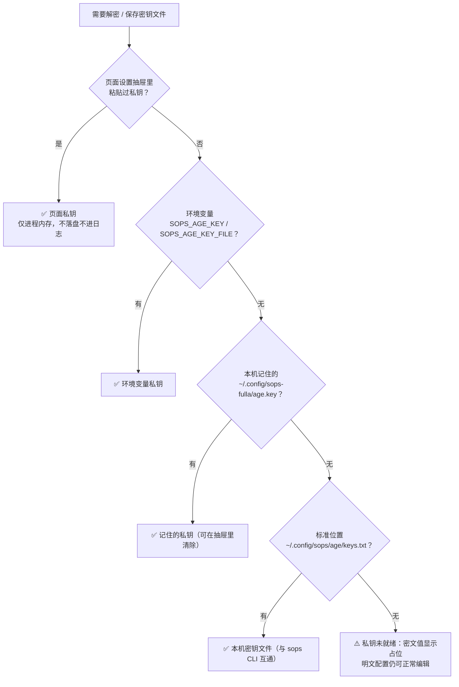
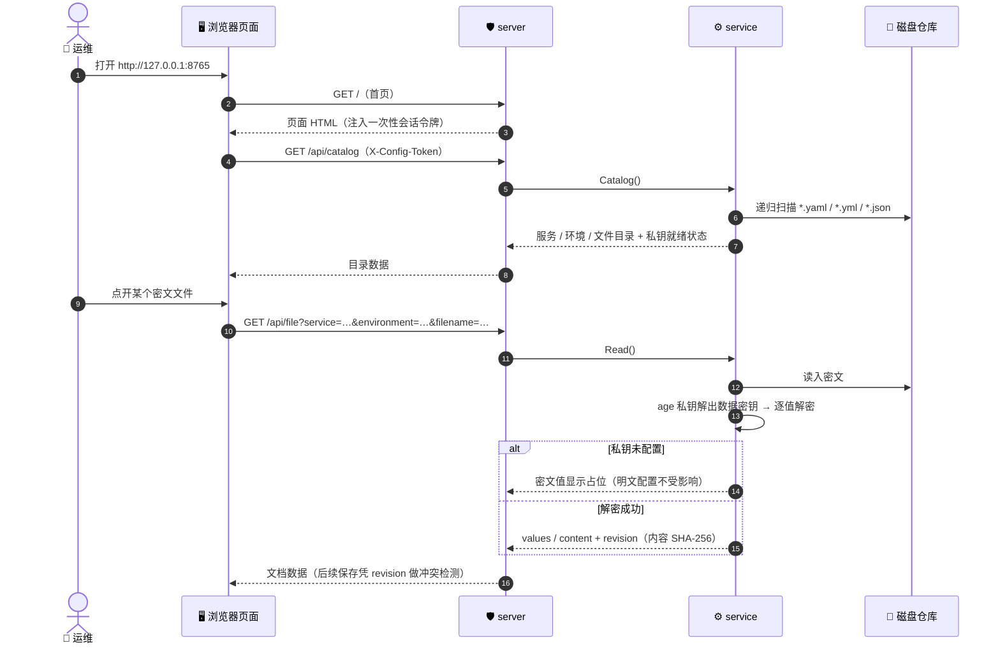
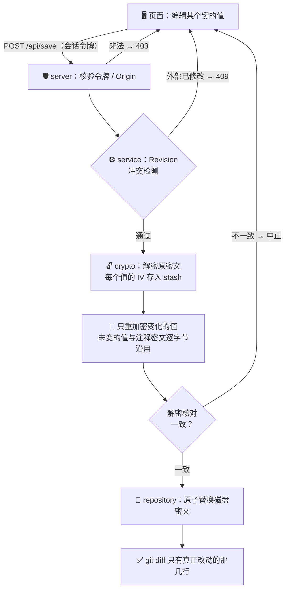
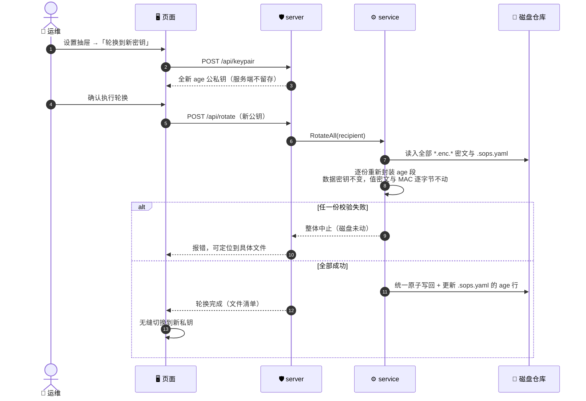

# sops-fulla

**简体中文** | [English](README_EN.md)

> 🔐 标准 SOPS 密文 · ⚡ 单二进制零依赖 · 🖥️ 本机管理页面 · 🔄 页面密钥轮换 · 🤝 与 sops CLI 双向互通

通用的本地配置仓库管理面板：浏览器页面维护任意层级目录里的
YAML / JSON 配置与 SOPS 密文，保存时自动加解密、未变化的值与注释
密文逐字节沿用（git diff 干净可读）；附带密文批量管理命令

**单二进制，零外部依赖** —— 不需要安装 sops / age / Python：加解密
基于官方 `getsops/sops/v3` 库在进程内原生完成，加密产物与 sops CLI
生成的文件完全同构

## 📖 名字由来

**Fulla（芙拉）** 是北欧神话中弗丽嘉（Frigg，诸神之后）的贴身侍女
她独自保管弗丽嘉的宝匣——里面放着女神最珍贵的秘密之物，也唯一知道
宝匣的钥匙藏在何处；哪怕奥丁想窥探，也得先过她这一关

这个工具做的是同一件事：**替你守护配置仓库里的秘密宝匣**——

- 宝匣里的东西（值密文）是标准 SOPS 格式，钥匙（age 私钥）始终在你
  手里，哪天 Fulla 不在了，`sops -d` 依然打得开
- 换钥匙（密钥轮换）不动宝匣里的东西，只换锁芯

## 📦 配置仓库约定

```text
<配置仓库>/
├── .sops.yaml                     age 公钥 + 「文件名带 .enc. 才加密」的规则
├── root.yaml                      直接放仓库根目录也行
├── demo-gateway/
│   ├── dev/
│   │   ├── config.dev.yaml        明文运行配置
│   │   └── secrets.enc.yaml       扁平 KEY: value 的密钥文件（SOPS 密文）
│   ├── secrets.enc.yaml           服务目录下（无环境子目录）也可以
│   └── team/
│       └── deep/
│           └── app.enc.yaml       多级嵌套目录同样支持
```

目录层级不限：页面按「服务 = 第一级目录，环境 = 其余目录路径」分组，
根目录文件自成一组约定可适配：密钥文件不叫 `secrets.enc.yaml` 的
仓库，用 `--secrets-name <文件名>` 换掉

## 🚀 获取与启动

**一键安装**（macOS / Linux，自动识别平台、校验 SHA-256，
装进 `~/.local/bin`）：

```bash
curl -fsSL https://raw.githubusercontent.com/kamalyes/sops-fulla/master/install.sh | sh
```

也可以指定版本或安装目录：

```bash
curl -fsSL -o /tmp/install.sh \
  https://raw.githubusercontent.com/kamalyes/sops-fulla/master/install.sh
sh /tmp/install.sh sops-fulla-ab12cd3        # 安装指定 Release 的 tag
INSTALL_DIR=/usr/local/bin sh /tmp/install.sh  # 换安装目录
```

或从 [Releases](https://github.com/kamalyes/sops-fulla/releases) 手动下载对应平台的
`sops-fulla`（darwin / linux 的 amd64、arm64，windows 的 amd64，
附 SHA-256 校验和），或本机有 Go 1.25+ 时直接 `go run`：

```bash
# 启动面板，--repo 指向任意配置仓库
sops-fulla --repo /path/to/service-configs
# 或
go run . --repo /path/to/service-configs

# 也可以不带 --repo 直接启动，在页面上选择工作区
sops-fulla

# 换端口 / 不自动开浏览器
sops-fulla --repo . --port 8766 --no-browser

# 密钥文件约定名不同的仓库
sops-fulla --repo . --secrets-name credentials.enc.yaml
```

默认打开 `http://127.0.0.1:8765`，按 Ctrl+C 退出

### 🗂 多工作区

管理页面支持多工作区：可以不带 `--repo` 直接启动，在页面引导卡片里
填写仓库路径，或从最近使用过的工作区列表里选择；之后随时在设置
抽屉的「工作区」区域切换。最近列表保存在本机
`~/.config/sops-fulla/workspaces.json`（最多 8 个，只保留仍含
`.sops.yaml` 的目录），也可用 `FULLA_CONFIG_DIR` 改存放位置。

### 🌱 从零初始化（init）

运维拿到二进制即可一条命令建好仓库，不需要单独安装 sops / age：

```bash
sops-fulla --repo /path/to/new-configs init
sops-fulla --repo /path/to/new-configs init --example   # 顺带生成一套可跑的示例
```

init 做三件事：

1. 生成 `.sops.yaml`（age 公钥 + `.enc.` 文件名规则），目录里已有则拒绝执行
2. 私钥写入本机标准位置 `~/.config/sops/age/keys.txt`（0600，**从不覆盖**
   —— 本机已有 sops 的密钥就直接复用，两边互通）
3. `--example` 时额外生成 `demo-gateway/dev/` 明文配置 + 密钥文件，
   并当场用工具自身加密，开箱即可 `status` / 页面查看

## 🤝 与 sops CLI 双向互通

工具只是 `getsops/sops/v3` 官方库的进程内封装，密文就是标准 SOPS
格式 —— **哪怕哪天这个工具没了，sops CLI 依然能解开这里产生的所有
密文**，反之 sops CLI 加密的文件本工具也能直接编辑：

```bash
# 用 sops CLI 解开本工具加密的文件（examples/basic 里有现成演示）
SOPS_AGE_KEY_FILE=examples/basic/demo-key.txt \
  sops -d examples/basic/demo-gateway/dev/secrets.enc.yaml

# sops CLI 加密的文件，直接用本工具打开编辑
sops-fulla --repo . edit path/to/sops-cli-encrypted.enc.yaml
```

密钥轮换（见下）也只换 metadata 里的 age 段，值密文与 MAC 不动，
sops CLI 同样无感

## 🔑 age 私钥

查看与保存密钥（解密）需要私钥，优先级从高到低：

1. **页面左下角私钥状态条（或右侧悬浮栏「设置」）→ 抽屉里直接粘贴** `AGE-SECRET-KEY-1…`
   —— 仅本次会话有效，保存在进程内存里，不落盘、不进日志；
   勾选「记住到本机」后存入 `~/.config/sops-fulla/age.key`（0600），
   下次启动自动加载，随时可在抽屉里清除
2. 环境变量 `SOPS_AGE_KEY` / `SOPS_AGE_KEY_FILE`
3. 本机密钥文件 `~/.config/sops/age/keys.txt`
   （macOS 也认 `~/Library/Application Support/sops/age/keys.txt`）

加密只需要 `.sops.yaml` 里的公钥，所以没配私钥的人也能编辑明文配置

### 私钥来源（流程图）



## 🔄 密钥轮换（页面支持）

怀疑私钥泄露、或定期换钥匙时，打开设置抽屉（左下角状态条或右侧悬浮栏
「设置」），在「轮换到新密钥」区域操作：

1. 点「生成新密钥对」得到一对全新的 age 公私钥（私钥只在浏览器响应里，
   服务端不保存），也可以直接粘贴已有的新公钥
2. 点「执行轮换」并确认：仓库里**全部**密文与 `.sops.yaml` 一起换到新公钥
3. 轮换成功后页面自动切换到新私钥，无需重新粘贴

轮换只重新封装 metadata 里的 age 段，**数据密钥不变，值密文与 MAC
逐字节不变** —— git diff 里只有 `sops.age` 那几行变化整个操作是
两阶段的：所有文件先在内存里轮换成功才统一落盘，中途任何一份失败
（比如某份密文被外部改坏）都整体中止，磁盘不动

命令行同样可以走 `keys` / `show` 确认轮换后文件可读

## 🖥️ 页面交互

- **服务目录**：左侧搜索框按名称过滤，Esc 清空
- **环境 / 文件页签**：页签上有未保存的圆点标记，切换前未保存会弹窗确认
- **环境密钥**：值默认隐藏；点击遮罩、或「查看 / 修改」展开编辑；
  「全部显示 / 全部隐藏」一键切换；每行有「复制」按钮（不解密显示也能复制值）；
  删除密钥走确认弹窗
- **保存**：右侧悬浮操作栏点「保存」（未保存时有琥珀色圆点标记），
  或按 ⌘S / Ctrl+S；结果以右下角 Toast 通知，点击通知可提前关闭
- 设置抽屉与确认弹窗统一支持 Esc 关闭；操作期间顶部有忙碌进度条

保存密钥文件时：只重加密变化的值（与 sops CLI edit 同机制，数据密钥
不轮换），解密核对一致后原子替换磁盘上的密文；失败或检测到外部修改
（409）时原文件不动；尚未创建密钥文件的环境可直接在页面添加第一项

页面不自动提交、推送或触发部署；仅监听 `127.0.0.1`，不加载外部资源，
不把密钥存进浏览器持久化缓存

## 🧭 核心流程

### 启动与查看（时序图）



### 保存一份密钥文件（流程图）



### 密钥轮换（时序图）



## 🧰 批量命令

```bash
sops-fulla --repo . status          # 每份是密文还是明文、各几个键（不打印值）
sops-fulla --repo . keys            # 只列键名（不打印值）
sops-fulla --repo . check           # 有明文就退 1（给 CI 或 pre-commit 用）
sops-fulla --repo . encrypt         # 把所有明文的就地加密，逐份验证解回来一致
sops-fulla --repo . decrypt --yes   # 就地解开全部（改完务必 encrypt 回去）
sops-fulla --repo . show [路径]      # 解出来打到标准输出，不落盘
sops-fulla --repo . edit <路径>      # 命令行交互编辑，保存时重新加密
```

`status` / `keys` / `check` 只看文件形态（有没有 SOPS 元数据块），
不需要私钥，也没有 sops 依赖 —— 适合直接放进 CI

## 🔌 给配置仓库接入（保持原入口不变）

配置仓库通常保留一个 `scripts/secrets.sh` 之类的入口找到本工具：

```bash
binary=""
[ -n "${FULLA_BIN:-}" ] && binary="${FULLA_BIN}"
[ -z "$binary" ] && [ -x bin/sops-fulla ] && binary="bin/sops-fulla"
[ -z "$binary" ] && command -v sops-fulla >/dev/null && binary="$(command -v sops-fulla)"
exec "${binary:-sops-fulla}" --repo "$(pwd)" "$@"
```

## 🗺️ 示例仓库

[examples/basic](examples/basic) 是一个开箱即用的演示仓库：含明文配置、
扁平密钥文件、多级嵌套密文，以及一对**公开的演示密钥**（仅用于体验，
别拿去加密真实配置）clone 下来即可：

```bash
go run . --repo examples/basic status
SOPS_AGE_KEY_FILE=examples/basic/demo-key.txt \
  go run . --repo examples/basic show demo-gateway/dev/secrets.enc.yaml
```

也可以用 `init --example` 在任意空目录生成同样的一套

## 🧪 开发

```bash
gofmt -l . && go vet ./... && go test ./...
node --check resources/web/app.js
```

测试自带原生加解密往返回归（测试内生成 age 密钥对），不依赖任何
外部工具要回归「真实密文格式」，把一份现有密文的路径放进
`FULLA_REAL_CIPHERTEXT` 再跑：

```bash
FULLA_REAL_CIPHERTEXT=/path/to/secrets.enc.yaml \
  go test ./service/ -run TestRealCiphertextParses -v
```

## 🏗️ 代码结构

```text
main.go / bootstrap/    薄入口与装配：flags 解析、子命令分发、init 引导、页面启动
server/                 管理页面的 HTTP 服务：令牌校验与静态资源
service/                读写编排：路径解析、文档校验、私钥管理、密钥轮换
batch/                  密文批量管理子命令（status / encrypt / edit …）
crypto/                 SOPS 原生加解密、最小 diff 重加密与密钥轮换
repository/             仓库扫描与路径校验（兼容任意层级放置）
models/                 保序文档模型与页面读写契约
errors/                 带状态码与错误码的业务错误
constants/              运行约定（端口、密钥文件名、环境变量名）
resources/              内嵌的页面静态资源（编译进二进制）
examples/basic/         开箱即用的演示仓库（公开演示密钥）
```

## 🚢 发布

推上 master 即自动测试、打包多平台二进制并发 Release
（`.github/workflows/release.yml`）；打 `v*` tag 时以 tag 名作为版本号
