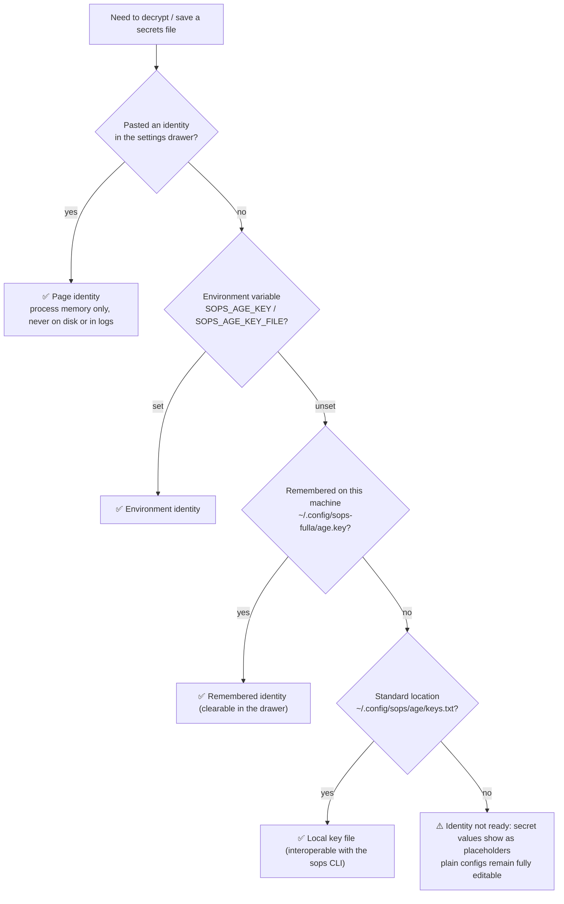
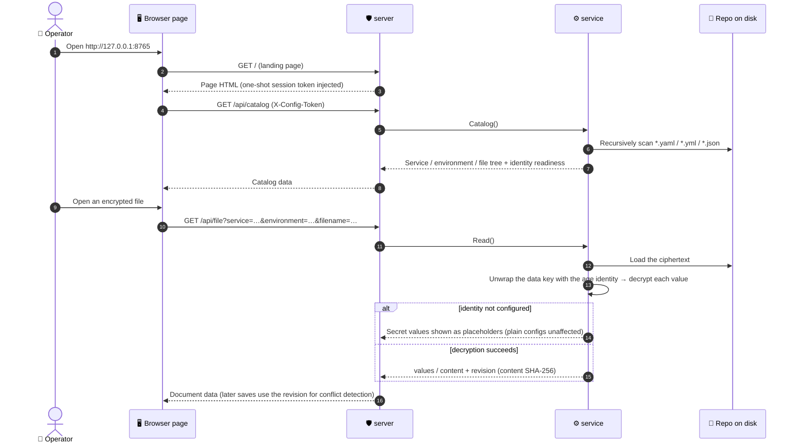
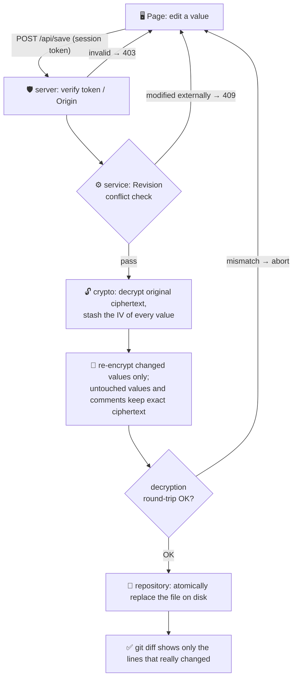

# sops-fulla

[简体中文](README.md) | **English**

> 🔐 Standard SOPS ciphertext · ⚡ Single binary, zero deps · 🖥️ Local dashboard · 🔄 In-page key rotation · 🤝 Two-way sops CLI compatibility

A general-purpose local dashboard for configuration repositories: maintain
YAML / JSON configs and SOPS-encrypted secrets in trees of any depth from
a browser page. Values and comments that did not change keep their exact
ciphertext on save (clean, readable git diffs); batch commands included.

**Single binary, zero external dependencies** — no sops / age / Python
required. Encryption is done natively in-process on top of the official
`getsops/sops/v3` library; the output is fully compatible with files
produced by the sops CLI.

## 📖 Why the Name

**Fulla** is the handmaiden of Frigg (queen of the Norse gods). She alone
keeps her mistress's coffer — the chest holding Frigg's most precious
secrets — and she alone knows where the key is hidden. Not even Odin gets
a peek without going through her.

This tool does the same job: **it keeps the coffer of secrets in your
configuration repository** —

- What's inside the coffer (value ciphertext) is standard SOPS format, and
  the key (your age identity) always stays in your hands. Even if Fulla
  is gone one day, `sops -d` still opens it
- Changing the key (key rotation) never touches what's inside — it only
  swaps the lock cylinder

## 📦 Repository Layout Convention

```text
<config-repo>/
├── .sops.yaml                     age recipient + "encrypt only *.enc.* files" rule
├── root.yaml                      files at the repo root work too
├── demo-gateway/
│   ├── dev/
│   │   ├── config.dev.yaml        plain runtime config
│   │   └── secrets.enc.yaml       flat KEY: value secrets file (SOPS ciphertext)
│   ├── secrets.enc.yaml           directly under the service dir (no env subdir) works
│   └── team/
│       └── deep/
│           └── app.enc.yaml       deeply nested directories are supported
```

Directory depth is unlimited: the page groups files as
"service = first-level directory, environment = remaining path"; root-level
files form their own group. The convention is adaptable: if your secrets
file is not called `secrets.enc.yaml`, override it with
`--secrets-name <filename>`.

## 🚀 Getting Started

Download `sops-fulla` for your platform from
[Releases](https://github.com/kamalyes/sops-fulla/releases)
(darwin / linux amd64 & arm64, windows amd64, with SHA-256 checksums), or
`go run` it directly with Go 1.25+:

```bash
# Start the dashboard against any config repository
sops-fulla --repo /path/to/service-configs
# or
go run . --repo /path/to/service-configs

# Or start without --repo and pick the workspace on the page
sops-fulla

# Custom port / don't auto-open the browser
sops-fulla --repo . --port 8766 --no-browser

# Repositories with a different secrets filename convention
sops-fulla --repo . --secrets-name credentials.enc.yaml
```

Opens `http://127.0.0.1:8765` by default; press Ctrl+C to quit.

### 🗂 Multiple Workspaces

The dashboard supports multiple workspaces: start without `--repo`,
type a repository path into the guide card (or pick one from the recent
list), and switch anytime via the "Workspace" section of the settings
drawer. The recent list lives in `~/.config/sops-fulla/workspaces.json`
(at most 8 entries, only directories still containing `.sops.yaml`),
and its location can be overridden with `FULLA_CONFIG_DIR`.

### 🌱 Initialize From Scratch (init)

Operators can bootstrap a repository with a single command — no separate
sops / age installation needed:

```bash
sops-fulla --repo /path/to/new-configs init
sops-fulla --repo /path/to/new-configs init --example   # also scaffold a runnable example
```

init does three things:

1. Generates `.sops.yaml` (age recipient + the `.enc.` filename rule);
   refuses to run if one already exists
2. Writes the identity to the standard location
   `~/.config/sops/age/keys.txt` (0600, **never overwrites** — if sops
   already put a key there, it is reused, so both tools interoperate)
3. With `--example`, additionally scaffolds `demo-gateway/dev/` plain
   config + secrets, encrypted on the spot by the tool itself — ready for
   `status` or the dashboard right away

## 🤝 Two-Way Compatibility With the sops CLI

This tool is merely an in-process wrapper around the official
`getsops/sops/v3` library; the ciphertext is standard SOPS format —
**even if this tool disappears someday, the sops CLI can still decrypt
everything it ever produced**, and vice versa, files encrypted by the
sops CLI can be edited here directly:

```bash
# Decrypt a file produced by this tool with the sops CLI (live demo in examples/basic)
SOPS_AGE_KEY_FILE=examples/basic/demo-key.txt \
  sops -d examples/basic/demo-gateway/dev/secrets.enc.yaml

# Open and edit a sops-CLI-encrypted file with this tool
sops-fulla --repo . edit path/to/sops-cli-encrypted.enc.yaml
```

Key rotation (below) only swaps the age section in the metadata; value
ciphertext and MAC stay untouched — the sops CLI never notices.

## 🔑 age Identity

Viewing and saving secrets (decryption) requires the identity,
highest priority first:

1. **Open Settings via the key status bar at the bottom-left (or the
   floating "Settings" button on the right) and paste it into the drawer**
   (`AGE-SECRET-KEY-1…`) — valid for this session only, kept in process
   memory, never written to disk or logs; tick "Remember on this
   machine" to store it in `~/.config/sops-fulla/age.key` (0600) so it
   loads automatically on the next start — clearable in the drawer anytime
2. Environment variables `SOPS_AGE_KEY` / `SOPS_AGE_KEY_FILE`
3. The local key file `~/.config/sops/age/keys.txt`
   (on macOS, `~/Library/Application Support/sops/age/keys.txt` too)

Encryption only needs the recipient in `.sops.yaml`, so people without
the identity can still edit plain configs.

### Identity Sources (Flowchart)



## 🔄 Key Rotation (Dashboard)

When you suspect the identity has leaked, or as periodic hygiene, open the
settings drawer (bottom-left status bar or the floating "Settings" button
on the right) and use the "Rotate to a new key" section:

1. Click "Generate new key pair" to get a fresh age recipient/identity
   pair (the identity only appears in the browser response and is never
   stored server-side), or paste an existing new recipient directly
2. Click "Rotate" and confirm: **all** ciphertext in the repository, along
   with `.sops.yaml`, switches to the new recipient
3. After a successful rotation the page automatically switches to the new
   identity — no re-pasting needed

Rotation only re-wraps the age section in the metadata: **the data key
stays the same, value ciphertext and MAC are byte-for-byte identical** —
the git diff contains only the few changed `sops.age` lines. The whole
operation is two-phase: every file is rotated in memory first and only
then written to disk; if any single file fails along the way (e.g. one
ciphertext was corrupted externally), everything is aborted and the disk
is left untouched.

You can also confirm readability after rotation via the `keys` / `show`
commands.

## 🖥️ Dashboard UX

- **Service tree**: filter by name in the left-side search box, Esc clears
- **Environment / file tabs**: unsaved dots on tabs; switching with
  unsaved changes asks for confirmation
- **Secrets**: values masked by default; click the mask or "view / edit"
  to expand; "show all / hide all" toggles; each row has a "copy" button
  (works without revealing the value); deleting a key asks for
  confirmation
- **Save**: click "Save changes" or press ⌘S / Ctrl+S; results appear as
  a toast in the bottom-right corner, click to dismiss early
- Dialogs cancel on Esc; a busy progress bar shows during operations

When saving a secrets file, only changed values are re-encrypted (same
mechanism as `sops CLI edit` — the data key is not rotated); after
verifying the decryption round-trips, the ciphertext on disk is replaced
atomically. On failure, or when an external modification is detected
(409), the file is left untouched. Environments without a secrets file
yet can add their first entry straight from the page.

The page never commits, pushes, or triggers deployments on its own; it
listens on `127.0.0.1` only, loads no external resources, and keeps no
secrets in browser persistent storage.

## 🧭 Core Flows

### Startup & Viewing (Sequence Diagram)



### Saving a Secrets File (Flowchart)



### Key Rotation (Sequence Diagram)

```mermaid
sequenceDiagram
    autonumber
    actor U as 👤 Operator
    participant P as 🖥️ Page
    participant S as 🛡️ server
    participant V as ⚙️ service
    participant D as 💾 Repo on disk

    U->>P: settings drawer → "Rotate to a new key"
    P->>S: POST /api/keypair
    S-->>P: fresh age key pair (never stored server-side)
    U->>P: confirm rotation
    P->>S: POST /api/rotate (new recipient)
    S->>V: RotateAll(recipient)
    V->>D: read all *.enc.* ciphertext and .sops.yaml
    V->>V: re-wrap the age section of each file;<br/>data key unchanged, value ciphertext and MAC byte-identical
    alt any file fails verification
        V-->>S: abort entirely (disk untouched)
        S-->>P: error, pinpointing the file
    else all succeed
        V->>D: atomically write everything back + update the age line in .sops.yaml
        S-->>P: rotation complete (file list)
        P->>P: seamlessly switch to the new identity
    end
```

## 🧰 Batch Commands

```bash
sops-fulla --repo . status          # per-file: ciphertext or plain, key count (no values)
sops-fulla --repo . keys            # list key names only (no values)
sops-fulla --repo . check           # exit 1 if any plaintext file (for CI / pre-commit)
sops-fulla --repo . encrypt         # encrypt all plaintext in place, verifying each round-trip
sops-fulla --repo . decrypt --yes   # decrypt everything in place (re-run encrypt afterwards)
sops-fulla --repo . show [path]     # print decrypted content to stdout, no disk writes
sops-fulla --repo . edit <path>     # interactive CLI editing, re-encrypts on save
```

`status` / `keys` / `check` only inspect file shape (presence of the SOPS
metadata block): no identity needed, no sops dependency — CI-friendly as
is.

## 🔌 Wiring Into a Config Repository (Keep Your Existing Entry Point)

Config repositories usually keep a `scripts/secrets.sh`-style entry point
that locates this tool:

```bash
binary=""
[ -n "${FULLA_BIN:-}" ] && binary="${FULLA_BIN}"
[ -z "$binary" ] && [ -x bin/sops-fulla ] && binary="bin/sops-fulla"
[ -z "$binary" ] && command -v sops-fulla >/dev/null && binary="$(command -v sops-fulla)"
exec "${binary:-sops-fulla}" --repo "$(pwd)" "$@"
```

## 🗺️ Example Repository

[examples/basic](examples/basic) is a ready-to-run demo repository: plain
configs, a flat secrets file, deeply nested ciphertext, and a pair of
**public demo keys** (for experimentation only — never use them for real
secrets). After cloning:

```bash
go run . --repo examples/basic status
SOPS_AGE_KEY_FILE=examples/basic/demo-key.txt \
  go run . --repo examples/basic show demo-gateway/dev/secrets.enc.yaml
```

You can also generate the same set in any empty directory with
`init --example`.

## 🧪 Development

```bash
gofmt -l . && go vet ./... && go test ./...
node --check resources/web/app.js
```

The test suite includes native encrypt/decrypt round-trip regressions
(age key pairs generated inside the tests) and depends on no external
tools. To regression-test against "real ciphertext format", point
`FULLA_REAL_CIPHERTEXT` at an existing ciphertext file:

```bash
FULLA_REAL_CIPHERTEXT=/path/to/secrets.enc.yaml \
  go test ./service/ -run TestRealCiphertextParses -v
```

## 🏗️ Code Layout

```text
main.go / bootstrap/    thin entry and wiring: flags, subcommand dispatch, init, server startup
server/                 dashboard HTTP service: token checks and static assets
service/                read/write orchestration: paths, validation, identity, rotation
batch/                  batch secret management subcommands (status / encrypt / edit …)
crypto/                 native SOPS crypto, minimal-diff re-encryption, key rotation
repository/             repository scanning and path validation (any nesting)
models/                 order-preserving document model and page contracts
errors/                 business errors with status and error codes
constants/              runtime conventions (port, secrets filename, env var names)
resources/              embedded web assets (compiled into the binary)
examples/basic/         ready-to-run demo repository (public demo keys)
```

## 🚢 Releasing

Pushing to master runs tests, builds multi-platform binaries and publishes
a Release automatically (`.github/workflows/release.yml`); pushing a `v*`
tag uses the tag name as the version.
